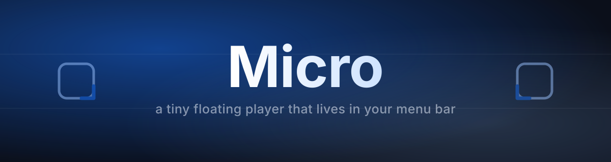
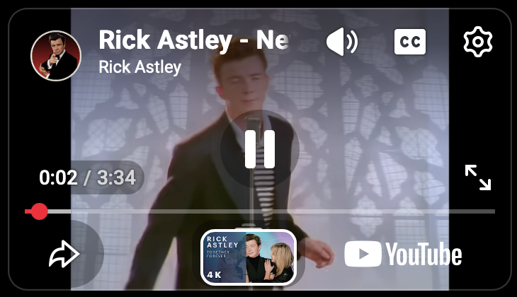
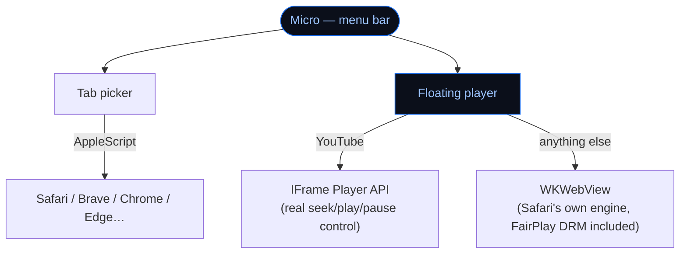

<p align="center">
  
</p>

<p align="center">
  
  
  
  
</p>

Plays YouTube, Netflix and pretty much anything else in a tiny floating window that stays on top of everything — no browser tab, no ads around it, no Dock icon to manage. Lives entirely in the menu bar.

<p align="center">
  
</p>

## Index

- [Why](#why)
- [Installation](#installation)
- [First launch](#first-launch)
- [Usage](#usage)
- [Keyboard shortcuts](#keyboard-shortcuts)
- [Permissions (first time only)](#permissions-first-time-only)
- [Settings](#settings)
- [How it fits together](#how-it-fits-together)
- [Known limitations](#known-limitations)
- [License](#license)

## Why

Sometimes you just want to keep half an eye on a video while you work, without a whole browser window and tab bar taking up space — and without the video pausing the moment you click away.

- A **real floating window**, always on top (optional), that keeps a clean 16:9 shape however you resize it.
- **No Dock icon, no app window** — just a small icon in the menu bar.
- Pick any **open browser tab** from a visual grid and it opens in the mini player; the original tab pauses itself.
- Remembers **where you left off**, down to the second, per video.

## Installation

Download the latest `Micro.dmg` from [Releases](../../releases), open it, and drag `Micro.app` into `Applications`.

> [!IMPORTANT]
> Micro isn't notarized by Apple (that needs a paid Developer account), so the first time you open it, Gatekeeper will say it can't verify the app. Right-click `Micro.app` → **Open** → confirm in the dialog, instead of double-clicking. You only need to do this once.

To build it yourself instead:

```sh
git clone https://github.com/alexcalatyd/Micro.git
cd Micro/App
./build.sh
```

That compiles it, signs it locally and installs it straight into `/Applications`.

## First launch

Micro has no Dock icon and no main window — look for its icon in the **menu bar**, top-right of the screen. The first time it opens, a short guide walks through the basics (in English by default, with a switch to Spanish right there).

## Usage

1. Click the **Micro icon** in the menu bar.
2. Click **Open browser tab**.
3. Pick any open tab from the grid — works with Safari, Brave, Chrome, Edge, Vivaldi and Opera, no extension needed.

The mini player opens right there, and the tab you picked it from pauses itself automatically.

- **Move** the window by dragging its top edge.
- **Resize** by dragging any of the four corners — it always keeps a 16:9 shape, no black bars.
- ⚙️ and the resize corners only show up while your mouse is over the window, and fade out a couple of seconds after you move it away.

## Keyboard shortcuts

These act on the video directly, no need to click into it first:

| Key | Action |
|---|---|
| `←` `→` | seek ±10s |
| `space` | play / pause |
| `⌘R` | reload |
| `⌘H` | hide the window (keeps playing — bring it back from the menu bar) |
| `⌘W` | close |

## Permissions (first time only)

- **Automation**, once per browser — so Micro can read its open tabs and pause the original one. macOS asks the first time you open the tab picker with that browser running.
- **Accessibility**, only as a fallback — if the browser doesn't have *"Allow JavaScript from Apple Events"* turned on (it's off by default), Micro falls back to focusing the tab and sending it the spacebar to pause, which needs this permission instead. Nothing to configure by hand either way.

## Settings

Click the menu bar icon or the ⚙️ inside any open window:

- **Always on top** or a normal window that can be covered by others.
- Three preset sizes (small / medium / large), all 16:9.
- Language for the settings panels (English / Spanish).

## How it fits together



<details>
<summary><b>Why WKWebView instead of Electron</b></summary>
<br>

Electron bundles Chromium, and Chromium doesn't ship Widevine DRM by default — Netflix breaks. WKWebView *is* Safari's own engine, so it gets the same FairPlay support Safari has, for free.

</details>

<details>
<summary><b>Why YouTube loads through the IFrame Player API, not a plain iframe</b></summary>
<br>

A bare embedded iframe as the page's only content returns a 153 error from YouTube. Loading it through the real IFrame Player API avoids that — and it's also the only way to drive play/pause/seek from Swift, since a cross-origin iframe can't be reached directly.

</details>

<details>
<summary><b>How the tab picker works without a browser extension</b></summary>
<br>

Through AppleScript (`NSAppleScript`), which every major macOS browser supports for listing and controlling tabs. macOS asks for an Automation permission the first time, per browser — same mechanism as any "app wants to control Safari" prompt.

</details>

## Known limitations

- Not notarized (see [Installation](#installation)) — right-click → Open the first time.
- Netflix and YouTube got the most testing; Twitch hasn't been exercised much.
- No ad blocking.
- Each tab you open in the mini player is its own independent window — no combined queue or playlist view.
- Cookies live in Micro's own, separate storage — logging into Netflix in your browser doesn't log you in inside Micro, and vice versa.

## License

MIT — see [LICENSE](LICENSE).
